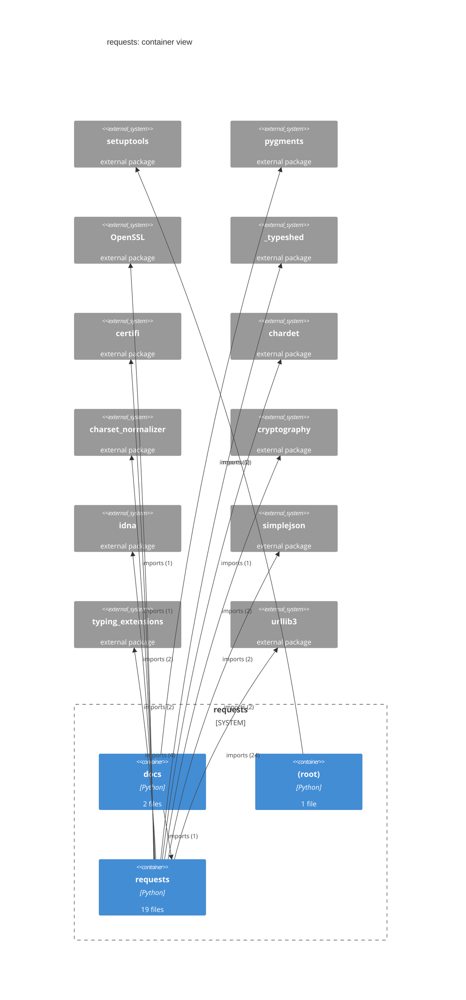

# c4-live

Draw the architecture of a Python or TypeScript repo from its own imports, and see which dependency edges a change added or removed between two git refs.

- Python imports are read with `ast`; TypeScript / JavaScript imports with a regex pass (no compiler, no `npm install`).
- Files are clustered into C4 levels: **context** (the system and the external packages it imports), **container** (top-level directories) and **component** (the next level down).
- Output is Mermaid C4 (default), PlantUML C4 or JSON.
- `diff REF_A REF_B` reads both refs with `git archive` (no checkout) and lists edges added and removed.
- Standard library only, Python 3.10+. MIT.

## Quickstart

```sh
git clone https://github.com/MegaStretch23/c4-live && cd c4-live
python3 -m c4_live scan /path/to/some/repo --level container          # Mermaid on stdout, a one-line summary on stderr
python3 -m c4_live scan /path/to/repo --level component --container src -o c4.mmd
python3 -m c4_live scan /path/to/repo --format plantuml -o c4.puml
python3 -m c4_live diff v1.0.0 main --repo /path/to/repo --level component           # text list
python3 -m c4_live diff v1.0.0 main --repo /path/to/repo --format mermaid -o diff.mmd # changed edges only: added green, removed red
python3 -m unittest discover -s tests -t .                              # 17 tests
```

`pip install .` installs a `c4-live` command with the same options. Paste a `.mmd` file into a fenced `mermaid` block on GitHub, or into the Mermaid live editor.

Options: `--level context|container|component|module`, `--container NAME` (component view limited to one container and its neighbours), `--include-tests` (test files are skipped by default), `--strip PREFIX` (path prefix to drop before clustering; the default drops a root `src/` and single-child directory chains), `--name`, `-o FILE`.

## Sample output from a saved run

Real run on [psf/requests](https://github.com/psf/requests) at tag v2.34.2 (commit `6e83187b`), `scan --level container`. The files in [`examples/`](examples) were produced by [`examples/regenerate.sh`](examples/regenerate.sh), which pins both repos' commits.

stderr: `22 files (22 Python), 86 internal and 44 external import statements`



Diff of the same repo, tag v2.31.0 to v2.34.2, `diff v2.31.0 v2.34.2 --level container`:

```
c4-live diff v2.31.0 -> v2.34.2 (level: container)
+ requests -> ext:_typeshed  (1 import statements)
+ requests -> ext:typing_extensions  (4 import statements)
- (root) -> ext:pytest  (1 import statements)
- requests -> ext:dummy_threading  (1 import statements)
2 edge(s) added, 2 removed
```

The `--level component` diff of the same two tags is in [`examples/requests-diff-component.txt`](examples/requests-diff-component.txt); a TypeScript run on [sindresorhus/ky](https://github.com/sindresorhus/ky) (commit `3541888`) is in [`examples/ky-container.mmd`](examples/ky-container.mmd).

## What it does not do (read before trusting a diagram)

- It counts import statements, including ones under `if TYPE_CHECKING:` and `import type`. A new edge can be a typing-only dependency (the new `_typeshed` and `typing_extensions` edges above are: every such import in `requests` sits under `if TYPE_CHECKING:`).
- An edge is a static import found in the source. Dynamic imports whose name is built at runtime, plugin loading and reflection are not seen.
- Python external names are the imported top-level module (`yaml`), not the PyPI distribution name (`PyYAML`). A package that imports itself by name in a separate directory, as `ky` does in its type tests, shows up as an external (`ext_ky` in `examples/ky-container.mmd`).
- TypeScript path aliases are followed only from a `tsconfig.json` / `jsconfig.json` at the repo root (`baseUrl`, `paths`) plus `@/` and `~/`. Nested tsconfig files and workspace package names are treated as external packages.
- Containers and components are directory heuristics, not a declared architecture. With one top-level package the "container" level collapses to that package; use `--level component` or `--strip`.
- The Mermaid output was checked to parse with mermaid's own parser (`mermaid.parse`, Node, not a browser render). The PlantUML output was not run through PlantUML.
- Only Python and TypeScript / JavaScript files are read. Files over 1 MB and files Python cannot parse are skipped, and the skipped count is printed.

## More from the same author

Unrelated to diagrams, the author also publishes pay-per-event Apify actors that pull structured SEC filings: [SEC Form 4 insider clusters](https://apify.com/johnveds15/sec-form4-insider-clusters) and [SEC 8-K material events](https://apify.com/johnveds15/sec-8k-material-events).
